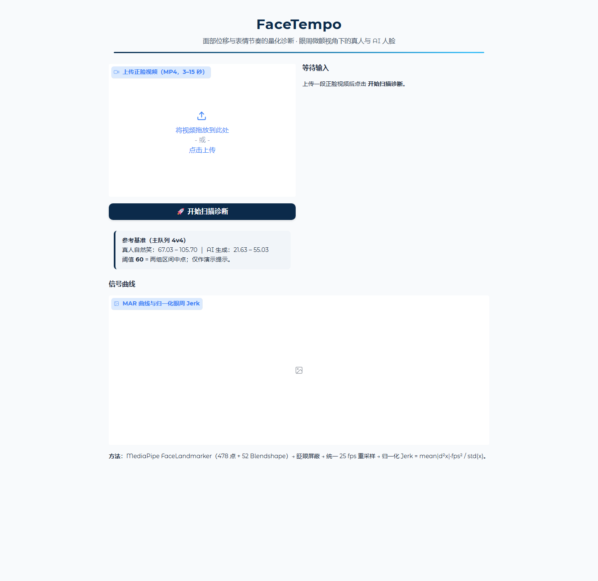
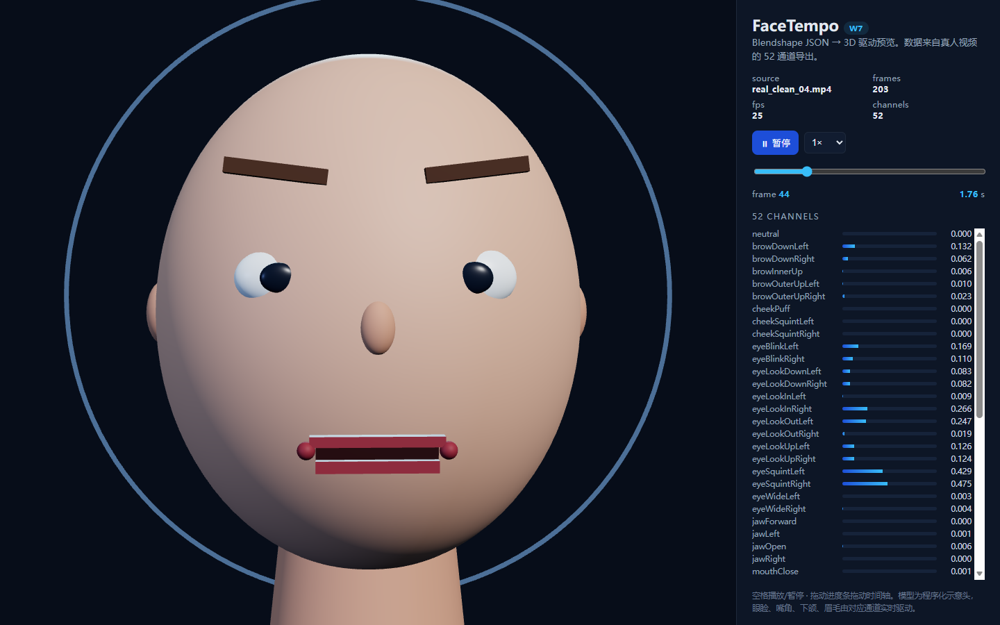

# FaceTempo 面速

**Diagnose the uncanny. Deconstruct the face.**

[English](#english) · [中文](#中文)

---

## English

FaceTempo is a facial **micro-tremor analyzer** and **52-channel blendshape exporter**.
It distinguishes real human video from AI-generated faces by measuring high-frequency
eye-region jitter, then exports a standard JSON that can drive a 3D avatar.

| Experiment | Real | AI | Result |
|---|---|---|---|
| Main cohort (4v4) | median 77.29 | median 35.63 | **p = 0.0143** (exact permutation) |
| Independent holdout (2v2) | 40.51 / 96.20 | 26.65 / 18.31 | **zero overlap**, p = 0.1667 (2v2 floor) |
| Real fake smile (n=4) | median 59.62 | — | between real and AI |

Metric: `normalized eye jerk = mean(|d²x|) · fps² / std(x)`, after blink masking,
3-frame smoothing and resampling to 25 fps.

```text
video → MediaPipe FaceLandmarker (478 pts + 52 blendshapes)
      → blink mask / 25 fps / normalized jerk / quality gates
      → diagnosis + prompt fix
      → 52-channel JSON → Three.js / GLB morph targets
```

### Quick start

```powershell
python -m venv venv
.\venv\Scripts\Activate.ps1        # Linux/macOS: source venv/bin/activate
pip install -r requirements.txt
python src/translator/auto_fetch_model.py   # optional: 3D sample model
python src/app/app.py
# http://127.0.0.1:7860
```

Batch analysis:

```powershell
python src/extract_landmarks.py --input data/raw/samples/w4_clean --blendshapes
python src/plot_dynamics.py --csv outputs/w4_final/features_curated2 --video_dir data/raw/samples/w4_clean
```

### Docs

- [Technical report](README_technical_report.md)
- [Deployment guide](DEPLOY_GUIDE.md)
- [Metric specification](docs/metrics_spec.md)
- [Known issues](docs/known_issues.md)
- [Blender / ARKit model guide](src/translator/BLENDER_GUIDE.md)

### Gallery




---

## 中文

FaceTempo（面速）是一个**面部微颤分析器**与**52 通道 Blendshape 导出器**：
用眼周高频抖动区分真人与 AI 生成人脸，并把表演导出为可驱动 3D 虚拟人的标准 JSON。

| 实验 | 真人 | AI | 结果 |
|---|---|---|---|
| 主队列 4v4 | 中位数 77.29 | 中位数 35.63 | **p = 0.0143**（精确置换检验） |
| 独立盲测 2v2 | 40.51 / 96.20 | 26.65 / 18.31 | **零重叠**，p=0.1667（2v2 下限） |
| 真人假笑 4 条 | 中位数 59.62 | — | 介于真人与 AI 之间 |

核心指标：`归一化眼周 Jerk = mean(|d²x|) · fps² / std(x)`，计算前做眨眼屏蔽、
3 帧中值平滑并统一重采样到 25 fps。

### 快速开始

```powershell
python -m venv venv
.\venv\Scripts\Activate.ps1
pip install -r requirements.txt
python src/translator/auto_fetch_model.py   # 可选：下载 3D 示例模型
python src/app/app.py
# http://127.0.0.1:7860
```

上传正脸视频即可得到：归一化眼周 Jerk、MAR 曲线、52 通道 JSON 驱动的 3D 复现，
以及一段可直接粘贴回 AI 视频工具的优化提示词。

### 文档

- [技术报告](README_technical_report.md)
- [部署指南](DEPLOY_GUIDE.md)
- [指标规范](docs/metrics_spec.md)
- [已知问题](docs/known_issues.md)
- [Blender / ARKit 模型指南](src/translator/BLENDER_GUIDE.md)

### 目录

```text
src/extract_landmarks.py     视频 → 关键点/Blendshape/特征 CSV
src/plot_dynamics.py         批量诊断、质量门控、置换检验
src/translator/              JSON 导出、3D 预览、模型获取
src/app/app.py               Gradio All-in-One 控制台
docs/                        指标规范、已知问题、报告
```

---

## License

MIT © FaceTempo 开发者
